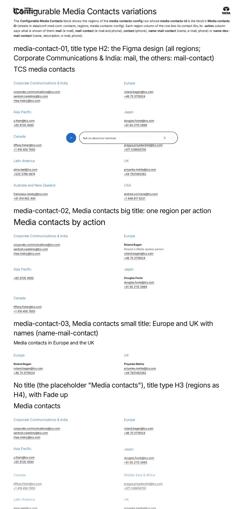
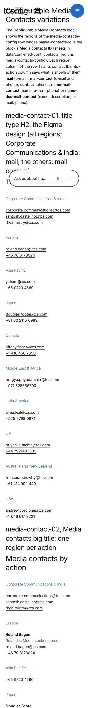

# Configurable Media Contacts Block — Developer Guide

| Attribute | Value |
| --- | --- |
| Document ID | DEV-B-conf-med-cont |
| Audience | Developers, technical leads, block owners, AI coding agents |
| Purpose | How the Configurable Media Contacts block is built: files, model, structure, behaviour, variations, tests and limitations |
| Scope | blocks/conf-med-cont/ and its components conf-med-cont |
| Prerequisites | — |
| Owner | Technical Lead / Block Owner (proposed) |
| Approver | Product Owner (to be confirmed) |
| Version | 1.0 |
| Status | Draft for review |
| Last updated | 22 November 2026 |
| Last validated | 2026-11-22 (model, files, imports from the code; reference pages from the live site) |
| Source files | blocks/conf-med-cont/README.md, blocks/conf-med-cont/_conf-med-cont.json, blocks/conf-med-cont/conf-med-cont-data.js, blocks/conf-med-cont/conf-med-cont.css, blocks/conf-med-cont/conf-med-cont.js |
| Related documents | [Variations](./CONF-MED-CONT-VARIATIONS.md), [Test coverage](./CONF-MED-CONT-TEST-COVERAGE.md), [Authoring guide](../../../03-authoring/components/conf-med-cont/CONF-MED-CONT-AUTHORING-GUIDE.md) |
| Related AEM paths | /content/tcs-corp/language-master/en/block-library/conf-med-cont, /content/tcs-corp/language-master/en/block-library/conf-med-cont/conf-med-cont-variations |

## Contents

- [Summary](#summary)
- [Overview](#overview)
- [Source files](#source-files)
- [Components, models and filters](#components-models-and-filters)
- [Fields](#fields)
- [Dependencies](#dependencies)
- [For Developers](#for-developers)
- [Extending the Block](#extending-the-block)
- [Responsive Behavior](#responsive-behavior)
- [Accessibility](#accessibility)
- [Data Layer and Analytics](#data-layer-and-analytics)
- [Performance Considerations](#performance-considerations)
- [Security and Privacy](#security-and-privacy)
- [For Architects](#for-architects)
- [Troubleshooting](#troubleshooting)
- [Known limitations of the block](#known-limitations-of-the-block)
- [Change history of the block](#change-history-of-the-block)
- [Reference pages](#reference-pages)
- [Coverage of the required topics](#coverage-of-the-required-topics)
- [Screenshots](#screenshots)
- [Known limitations](#known-limitations)
- [Open items](#open-items)
- [Change history](#change-history)

## Summary

| Attribute | Value |
| --- | --- |
| Block | Configurable Media Contacts |
| Folder | `blocks/conf-med-cont` |
| Type | Independent |
| Category | listing |
| Status | Active |
| Purpose | The regions of a media-contacts-config row of the data/conf-med-cont sheets, each with its contacts as its region action shows them |
| Variations (summary) | Media contacts title type H1-H6, big title, small title; region actions mail, mail-contact, contact, name-mail-contact, name-des-mail-contact |
| Children | — |
| Code size | 299 lines of JS and CSS |

## Overview

- **Business purpose:** one set of contacts and regions, maintained in sheets, shown in different combinations on different pages (press releases, newsroom, regional pages) without editing the pages.
- **User experience:** the title (e.g. "TCS media contacts"); below it the regions, two per row from 900px, one column below; each region's name in brand blue, then its contacts as its action shows them: e-mail addresses and phone numbers as underlined links, with the contact's name (and description) above them for the name actions.
- **Templates / page types:** any; typically press releases and newsroom pages.
- **Data source:** `/{root}/data/conf-med-cont/contacts.json`, `regions.json` and `media-contacts-config.json` (the sheets below `/content/tcs-corp/<root>/data/conf-med-cont/` on the author), read by `utils/data.js` `getConfMedCont`; pages below a review root (`/language-master/en`, `/language-masters/en`, `/design-block-master/en`) read their root's sheets, the locales their own (`REVIEW_SHEETS` in `utils/site.js`).
- **Related blocks:** Media Contacts (`blocks/media-contacts`: contacts authored as items in the block), whose look and markup it shares (`decorators/contact-list-decorator.js`).
- **When to use:** when the same contacts appear on several pages, or the regions and contacts change without page edits.
- **When not to use:** for contacts of one page only (use Media Contacts and author them as items).
- **Realistic use cases:** the "TCS media contacts" section of every press release (one config row); a regional press page showing only Europe and the UK (another config row); a newsroom page with names and descriptions (`name-des-mail-contact`).

## Source files

| File | Link |
| --- | --- |
| `README.md` | [GitHub](https://github.com/sradha-tcs/tcs-corp/blob/main/blocks/conf-med-cont/README.md) |
| `_conf-med-cont.json` | [GitHub](https://github.com/sradha-tcs/tcs-corp/blob/main/blocks/conf-med-cont/_conf-med-cont.json) |
| `conf-med-cont-data.js` | [GitHub](https://github.com/sradha-tcs/tcs-corp/blob/main/blocks/conf-med-cont/conf-med-cont-data.js) |
| `conf-med-cont.css` | [GitHub](https://github.com/sradha-tcs/tcs-corp/blob/main/blocks/conf-med-cont/conf-med-cont.css) |
| `conf-med-cont.js` | [GitHub](https://github.com/sradha-tcs/tcs-corp/blob/main/blocks/conf-med-cont/conf-med-cont.js) |

## Components, models and filters

| Component | Title | Resource type | Template name | Model | Children allowed |
| --- | --- | --- | --- | --- | --- |
| `conf-med-cont` | Configurable Media Contacts | `core/franklin/components/block/v1/block` | Conf Med Cont | `conf-med-cont` | — |

## Fields

The Additional tab fields (anchor, hide, padding, margin, animation) are common to the blocks and described in the [content modeling guide](../../markdown/CONTENT-MODELING-GUIDE.md).

### Configurable Media Contacts (`conf-med-cont`)

| Tab | Label | Property | Type | Required in model | Default | Options | Visibility |
| --- | --- | --- | --- | --- | --- | --- | --- |
| Content | Media contacts title | `media-contacts-title` | text | No | — | — | — |
| Content | Media contacts title type | `media-contacts-title-type` | select | No | — | 8 options | — |
| Content | Media contacts ID | `media-contacts-id` | text | No | — | — | — |

"Required in model" is the model's `required` flag; whether a field is required in practice is stated in the authoring guide where it is known.

## Dependencies

| Import |
| --- |
| `../../utils/links.js` |
| `../../decorators/contact-list-decorator.js` |
| `../../decorators/heading-decorator.js` |
| `../../scripts/scripts.js` |
| `../../utils/data.js` |
| `../../utils/environment.js` |
| `../../utils/placeholders.js` |
| `../../utils/properties.js` |
| `./conf-med-cont-data.js` |

## For Developers

<!-- BEGIN GENERATED: files (npm run build:docs) -->

```text
blocks/conf-med-cont/
├── README.md
├── _conf-med-cont.json
├── conf-med-cont-data.js
├── conf-med-cont.css
└── conf-med-cont.js
```

| Decorator/Utility | Purpose | Execution or dependency point |
| ----------------- | ------- | ----------------------------- |
| [`utils/links.js`](https://github.com/sradha-tcs/tcs-corp/blob/main/utils/links.js) | `NEW_WINDOW`, `linkOf`, `linkPathsOf` (the paths of a page property, one or many), `readLinkItems` (CTA lists with Link Type and the items' other select values), `readLinkRows` (the same from link item rows, e.g. Hero CT | `conf-med-cont-data.js`: { telHref } |
| [`decorators/contact-list-decorator.js`](https://github.com/sradha-tcs/tcs-corp/blob/main/decorators/contact-list-decorator.js) | `buildContactList` (contacts, each with its heading and its mail / phone links one below the other, or its `people`: name and description above each person's links; the links carry `data-cmp-interaction` email / phone) | `conf-med-cont.js`: { buildContactList } |
| [`decorators/heading-decorator.js`](https://github.com/sradha-tcs/tcs-corp/blob/main/decorators/heading-decorator.js) | `buildHeading` (Title + Title Type), `HEADINGS` | `conf-med-cont.js`: { HEADINGS } |
| [`scripts/scripts.js`](https://github.com/sradha-tcs/tcs-corp/blob/main/scripts/scripts.js) | Page decoration (moveInstrumentation and shared page helpers) | `conf-med-cont.js`: { moveInstrumentation } |
| [`utils/data.js`](https://github.com/sradha-tcs/tcs-corp/blob/main/utils/data.js) | `loadDataSheet`, `getAuthor`, `getAuthors`, `getLocations`, `getPartners`, `getSocialLinks`, `getMediaContacts`, `getConfMedCont` (the three `data/conf-med-cont/` sheets: contacts, regions, media-contacts-config), `inReg | `conf-med-cont.js`: { getConfMedCont } |
| [`utils/environment.js`](https://github.com/sradha-tcs/tcs-corp/blob/main/utils/environment.js) | `prefersReducedMotion`, `scrollBehavior`, `isEditing`, `isInEditor`, `isAuthor` (the page is rendered by AEM author, which has no query index) | `conf-med-cont.js`: { isAuthor, isEditing } |
| [`utils/placeholders.js`](https://github.com/sradha-tcs/tcs-corp/blob/main/utils/placeholders.js) | `getPlaceholders`, `loadPlaceholders`, `fillPlaceholder` (UI text from the locale's placeholders, with English fallbacks) | `conf-med-cont.js`: { getPlaceholders } |
| [`utils/properties.js`](https://github.com/sradha-tcs/tcs-corp/blob/main/utils/properties.js) | `readProperties`, `textOf`, `isOn`, `isOnByDefault` (a toggle that defaults to on), `optionOf`, `normalizeKey`, `textSource` (key-value block properties) | `conf-med-cont.js`: { readProperties, textOf, textSource } |

<!-- END GENERATED: files -->

- `conf-med-cont.js` reads the three properties (`readProperties`: `mediacontactstitle`, `mediacontactstitletype`, `mediacontactsid`), loads the sheets (`getConfMedCont`) and the placeholders in parallel, builds the title and renders the regions with `buildContactList` (each region a contact with `people`).
- `conf-med-cont-data.js` (pure, unit tested in `test/conf-med-cont/conf-med-cont-data.test.mjs`): `findConfig`, `regionColumns` (the dynamic region columns), `actionOf`, `regionGroups` (the regions with the details their actions show, and the IDs the sheets don't have).
- `decorators/contact-list-decorator.js` renders `people` (name, description, then their links) besides the Media Contacts block's plain links; `telHref` is in `utils/links.js` (shared with Media Contacts).
- Animation: `CONTENT_TARGETS` in `decorators/motion-decorator.js` (the title and each region).

```html
<div class="conf-med-cont block">
  <h2 class="conf-med-cont-title">TCS media contacts</h2>
  <ul class="contact-list">
    <li class="contact-list-contact" data-cmp-position="1">
      <h3 class="contact-list-heading">Europe</h3>
      <ul class="contact-list-entries">
        <li class="contact-list-person">
          <p class="contact-list-name">Roland</p>
          <p class="contact-list-description">Roland is Media spokes person</p>
          <ul class="contact-list-entries">
            <li class="contact-list-email"><a class="contact-list-link" href="mailto:roland.bagen@tcs.com" data-cmp-interaction="email" data-cmp-value="Europe"><span class="visually-hidden">Email: </span><span class="contact-list-text">roland.bagen@tcs.com</span></a></li>
            <li class="contact-list-phone"><a class="contact-list-link" href="tel:+46703178024" data-cmp-interaction="phone" data-cmp-value="Europe"><span class="visually-hidden">Phone: </span><span class="contact-list-text">+46 70 3178024</span></a></li>
          </ul>
        </li>
      </ul>
    </li>
  </ul>
</div>
```

## Extending the Block

- A new action: add it to `ACTIONS` in `conf-med-cont-data.js` (the details it shows, in order), with a test, and to the table above.
- A new detail of a contact (e.g. a LinkedIn link): a column of the contacts sheet, read in `getConfMedCont`, shown by `regionGroups` and rendered in the contact list decorator.

## Responsive Behavior

- Below 900px: one column; title 28px (`--heading-font-size-xl`), region names 16px (`--heading-font-size-s`).
- From 900px: two columns filled row by row (as in the design); title 40px, region names 20px.
- Contact lines are 16px at every width; long addresses wrap anywhere.

## Accessibility

- The title is a heading at the authored level, the region names one level below (H3 under an H2), so the outline stays in order.
- Each link has a visually hidden label (placeholders `email` "Email", `phone` "Phone") before the address or number.
- Underlined links in the text colour with a brand-colour hover and a 2px focus outline (WCAG 2.1 AA contrast: `--color-text-default` and `--color-text-brand` on white).
- Contacts are lists (`ul` / `li`), people with a name are list items of their own.

## Data Layer and Analytics

Links carry `data-cmp-interaction` `email` / `phone` and `data-cmp-value` the region name; the data layer decorator records the kind of link, never the address or number (`utils/privacy.js` `contactLinkKind`). The block is in the data layer as `conf-med-cont` with its position like any block.

## Performance Considerations

Three small JSON requests (cached for the page, in parallel with the placeholders) when the block is decorated; no layout reads, no dependencies.

## Security and Privacy

Contact details are public press contacts from the sheets; the text is set with `textContent`. The data layer gets the region name and the kind of link, not addresses or numbers.

## For Architects

- A sheet-driven companion of the Media Contacts block (decision log KB-D-073, Approved by the product owner on 22 November 2026): the contacts are data, the page only references a configuration. It reuses the Media Contacts markup and decorator, and the data utils' sheet loading (one request per sheet, cached per page).
- The config sheet's region columns are read by name pattern, so the sheet can grow without code changes.

## Troubleshooting

| Symptom | Cause |
|---|---|
| The block is missing on the published page | No config row with the ID, or none of its contacts has a detail to show; check on the author for the hint |
| A region has no name | The region ID isn't in the regions sheet (listed in the author hint) |
| Old contacts are shown | The sheets weren't republished after the change |

## Known limitations of the block

- The region names come only from the regions sheet; `region-desc` isn't shown.
- Universal Editor offers the Media contacts ID as a free text field (no list of the config rows).
- Screenshots of the block on AEM and of its dialog: Not recorded (no author access when it was built).

## Change history of the block

| Date | Change |
|---|---|
| 22 November 2026 | Created; KB-D-073 approved (product owner) |

## Reference pages

| Kind | Page | Live URL |
| --- | --- | --- |
| Block library | /language-master/en/block-library/conf-med-cont | https://main--tcs-corp--sradha-tcs.aem.live/language-master/en/block-library/conf-med-cont |
| Block library | /language-master/en/block-library/conf-med-cont/conf-med-cont-variations | https://main--tcs-corp--sradha-tcs.aem.live/language-master/en/block-library/conf-med-cont/conf-med-cont-variations |

## Coverage of the required topics

| Topic | Where |
| --- | --- |
| Purpose | Overview |
| Source files | generated: Files |
| Model, definition, filters, children | generated: Components |
| Dependencies | generated: Dependencies |
| Authored input / rendered output / DOM transformation | For Developers |
| Configuration fields, defaults, required fields | generated: Fields |
| Variations | CONF-MED-CONT-VARIATIONS.md |
| Responsive behaviour | Responsive Behavior |
| Accessibility and keyboard | Accessibility |
| Analytics / data layer | Data Layer and Analytics |
| Performance | Performance Considerations |
| Security | Security and Privacy |
| Extending | Extending the Block |
| Known limitations | Known Limitations |
| Troubleshooting | Troubleshooting |
| Tests | CONF-MED-CONT-TEST-COVERAGE.md |
| SEO behaviour | Not recorded |
| Caching considerations | Not recorded (Edge Delivery default caching; no block-specific rule) |
| Ownership | Technical Lead / Block Owner (proposed) |

## Screenshots



*Figure: Configurable Media Contacts block library page — desktop 1440 × 900 (/language-master/en/block-library/conf-med-cont/conf-med-cont-variations, captured 2026-11-22).*



*Figure: Configurable Media Contacts block library page — mobile 375 × 812 (/language-master/en/block-library/conf-med-cont/conf-med-cont-variations, captured 2026-11-22).*

## Known limitations

- Universal Editor dialogs were not captured: no author access in this program (see the access blockers).

## Open items

- None.

## Change history

| Version | Date | Author | Change |
| --- | --- | --- | --- |
| 1.0 | 22 November 2026 | Delivery team (documentation program) | First version of the role-specific documentation (master documentation prompt), generated from the repository and the published reference pages |
