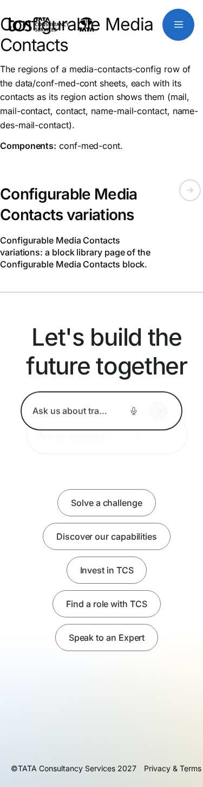
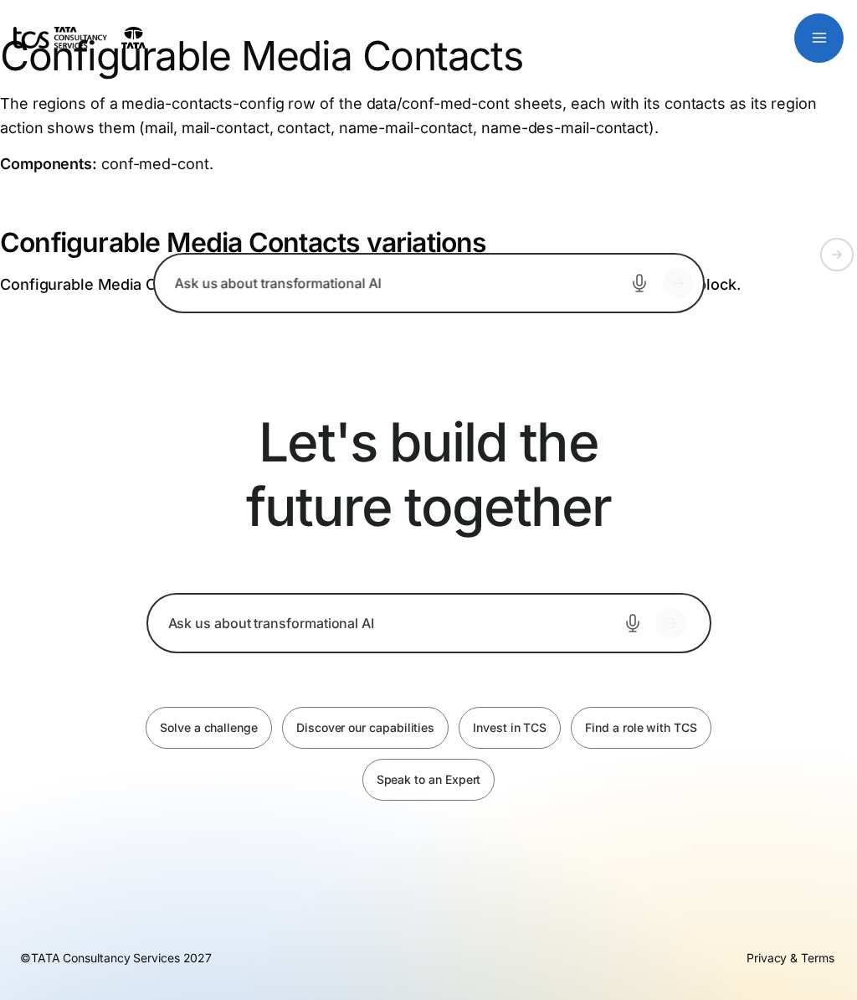
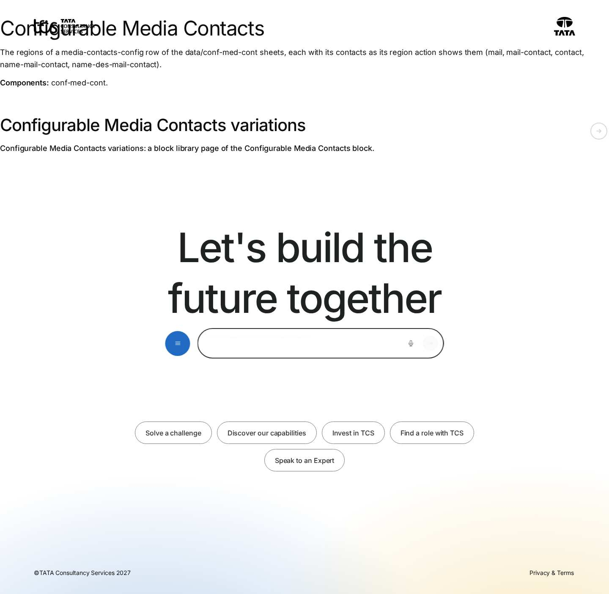
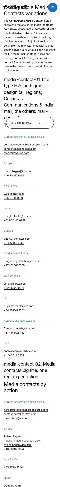
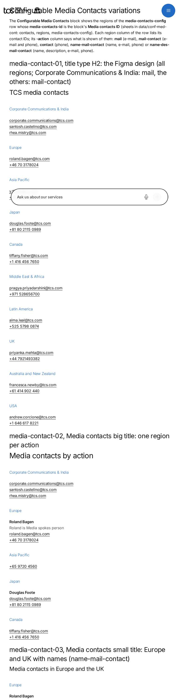
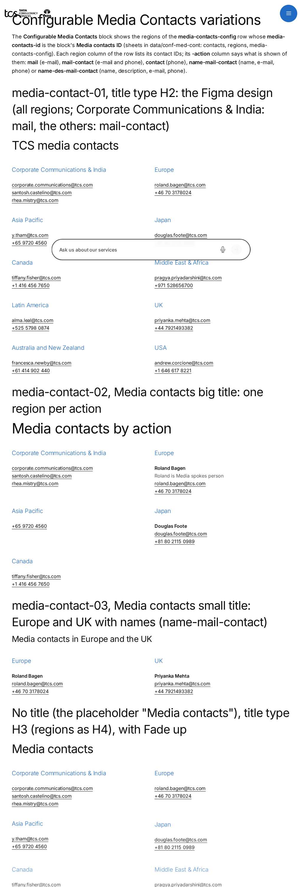
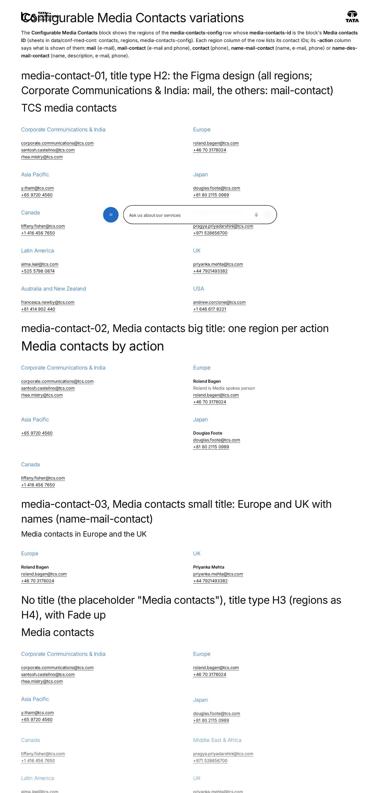

# Configurable Media Contacts Block — Test Coverage

| Attribute | Value |
| --- | --- |
| Document ID | DEV-T-conf-med-cont |
| Audience | Developers, technical leads, block owners, AI coding agents |
| Purpose | Unit tests, automated reference-page checks and manual test guidance for the block |
| Scope | — |
| Prerequisites | — |
| Owner | Technical Lead / Block Owner (proposed) |
| Approver | Product Owner (to be confirmed) |
| Version | 1.0 |
| Status | Draft for review |
| Last updated | 22 November 2026 |
| Last validated | 22 November 2026 |
| Source files | test/conf-med-cont/conf-med-cont-data.test.mjs |
| Related documents | — |
| Related AEM paths | — |

## Contents

- [Unit tests](#unit-tests)
- [Automated checks of the block library pages (executed 22 November 2026)](#automated-checks-of-the-block-library-pages-executed-22-november-2026)
- [Manual test guidance (block README)](#manual-test-guidance-block-readme)
- [Screenshots](#screenshots)
- [Known limitations](#known-limitations)
- [Open items](#open-items)
- [Change history](#change-history)

## Unit tests

| File | Suites | Tests |
| --- | --- | --- |
| `test/conf-med-cont/conf-med-cont-data.test.mjs` | findConfig; actionOf; regionColumns; regionGroups | 11 |

## Automated checks of the block library pages (executed 22 November 2026)

Per page: HTTP status and horizontal overflow at 375 / 768 / 1024 / 1440 px, console errors, failed requests and DOM accessibility checks at 1440 px (evidence: [screenshot register](../../../SCREENSHOT-REGISTER.md)).

| Page | 375 / 768 / 1024 / 1440 | Console errors | Failed requests | Accessibility (DOM) |
| --- | --- | --- | --- | --- |
| /language-master/en/block-library/conf-med-cont | ok / ok / ok / ok | 0 | 0 | 0 img no alt, 0 unnamed buttons, 1 heading skips |
| /language-master/en/block-library/conf-med-cont/conf-med-cont-variations | ok / ok / ok / ok | 0 | 0 | 0 img no alt, 0 unnamed buttons, 0 heading skips |

## Manual test guidance (block README)

| # | Check | Expected |
|---|---|---|
| 1 | ID `media-contact-01` with five regions and the five actions | Each region shows exactly the details of its action, contacts in the column order |
| 2 | A region column left empty | The region isn't shown |
| 3 | An unknown contact ID in a region | Shown in the author hint ("Not in the contacts or regions sheet: C0404"); the other contacts render |
| 4 | An unknown Media contacts ID | Author: the hint; published page: the block is hidden |
| 5 | Title type big / small title | An H2 at 48px / 28px (desktop) |
| 6 | 375px and 1440px | One column / two columns, no horizontal scroll |

Test cases: [05-quality-assurance/test-cases/blocks/conf-med-cont](../../../05-quality-assurance/test-cases/blocks/conf-med-cont/CONF-MED-CONT-TEST-CASES.md).

## Screenshots

*Figure: Configurable Media Contacts: conf-med-cont — mobile 375 × 812 (/language-master/en/block-library/conf-med-cont, captured 2026-11-22).*

*Figure: Configurable Media Contacts: conf-med-cont — tablet 768 × 900 (/language-master/en/block-library/conf-med-cont, captured 2026-11-22).*

*Figure: Configurable Media Contacts: conf-med-cont — small desktop 1024 × 900 (/language-master/en/block-library/conf-med-cont, captured 2026-11-22).*

*Figure: Configurable Media Contacts: conf-med-cont — desktop 1440 × 900 (/language-master/en/block-library/conf-med-cont, captured 2026-11-22).*

*Figure: Configurable Media Contacts: conf-med-cont/conf-med-cont-variations — mobile 375 × 812 (/language-master/en/block-library/conf-med-cont/conf-med-cont-variations, captured 2026-11-22).*

*Figure: Configurable Media Contacts: conf-med-cont/conf-med-cont-variations — tablet 768 × 900 (/language-master/en/block-library/conf-med-cont/conf-med-cont-variations, captured 2026-11-22).*

*Figure: Configurable Media Contacts: conf-med-cont/conf-med-cont-variations — small desktop 1024 × 900 (/language-master/en/block-library/conf-med-cont/conf-med-cont-variations, captured 2026-11-22).*

*Figure: Configurable Media Contacts: conf-med-cont/conf-med-cont-variations — desktop 1440 × 900 (/language-master/en/block-library/conf-med-cont/conf-med-cont-variations, captured 2026-11-22).*

## Known limitations

- None recorded for this document.

## Open items

- None.

## Change history

| Version | Date | Author | Change |
| --- | --- | --- | --- |
| 1.0 | 22 November 2026 | Delivery team (documentation program) | First version of the role-specific documentation (master documentation prompt), generated from the repository and the published reference pages |
