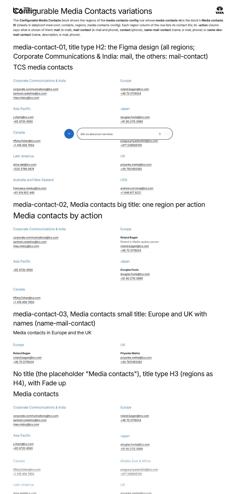
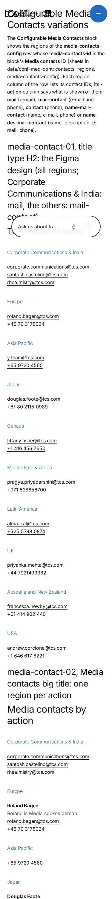

# Configurable Media Contacts — Authoring Guide

| Attribute | Value |
| --- | --- |
| Document ID | AUT-C-conf-med-cont |
| Audience | Content authors, content managers, AEM authoring leads |
| Purpose | How to add, fill in and check the Configurable Media Contacts component |
| Scope | — |
| Prerequisites | — |
| Owner | Content Lead / AEM Authoring Lead (proposed) |
| Approver | Product Owner (to be confirmed) |
| Version | 1.0 |
| Status | Draft for review |
| Last updated | 22 November 2026 |
| Last validated | 22 November 2026 |
| Source files | blocks/conf-med-cont/README.md, blocks/conf-med-cont/_conf-med-cont.json |
| Related documents | — |
| Related AEM paths | — |

## Contents

- [Where to see it](#where-to-see-it)
- [For Content Authors](#for-content-authors)
- [Authorable Fields](#authorable-fields)
- [Screenshot-Based Authoring Steps](#screenshot-based-authoring-steps)
- [Variations](#variations)
- [Complete Authoring Example](#complete-authoring-example)
- [Content and Asset Guidelines](#content-and-asset-guidelines)
- [Troubleshooting](#troubleshooting)
- [Screenshots](#screenshots)
- [Known limitations](#known-limitations)
- [Open items](#open-items)
- [Change history](#change-history)

## Where to see it

- https://main--tcs-corp--sradha-tcs.aem.live/language-master/en/block-library/conf-med-cont
- https://main--tcs-corp--sradha-tcs.aem.live/language-master/en/block-library/conf-med-cont/conf-med-cont-variations

## For Content Authors

1. Make sure the three sheets below `data/conf-med-cont/` of your site root hold the contacts, regions and a config row, and are published.
2. Add **Configurable Media Contacts** to a section, a Columns Container column or a tab.
3. Enter the **Media contacts title**, choose its **Media contacts title type** and enter the **Media contacts ID** of a config row.

In Universal Editor and on the author, the block says when the ID isn't in the config sheet, and which contact or region IDs of the row the sheets don't have. On the published page a block without contacts is hidden.

## Authorable Fields

<!-- BEGIN GENERATED: fields (npm run build:docs) -->

#### Configurable Media Contacts (`conf-med-cont`)

Model `conf-med-cont`; template name "Conf Med Cont" (the block class AEM renders); key-value block (one row per property).

##### Content tab — Configurable Media Contacts

| Field label | Property | Type | Required | Default | Allowed values | Author guidance | Example |
| ----------- | -------- | ---- | -------- | ------- | -------------- | --------------- | ------- |
| Media contacts title | `media-contacts-title` | text | No | — | — | The block's title, e.g. TCS media contacts; without one the heading is Media contacts (placeholder mediaContacts). | TCS media contacts |
| Media contacts title type | `media-contacts-title-type` | select | No | — | H1 (`h1`), H2 (`h2`), H3 (`h3`), H4 (`h4`), H5 (`h5`), H6 (`h6`), Media contacts big title (`media-contacts-big-title`), Media contacts small title (`media-contacts-small-title`) | H1 to H6: the title's heading level. Big title / small title: an H2 in the big or small title style. The region names are one level below the title. | h2 |
| Media contacts ID | `media-contacts-id` | text | No | — | — | The media-contacts-id of a row of the media-contacts-config sheet (data/conf-med-cont), e.g. media-contact-01: its region columns choose the regions, their contacts and what is shown of them. | media-contact-01 |

##### Additional tab — Configurable Media Contacts

| Field label | Property | Type | Required | Default | Allowed values | Author guidance | Example |
| ----------- | -------- | ---- | -------- | ------- | -------------- | --------------- | ------- |
| Anchor ID | `classes_anchor` | text | No | — | regExp: ^anchor-[a-z0-9][a-z0-9-]*$; customErrorMsg: Start with anchor-, then lower-case letters, digits and hyphens. | A unique ID of the block on the page, starting with anchor-, e.g. anchor-our-services; link to it with #anchor-our-services. Delivered as a block class. | — |
| Hide block | `classes_hideblock` | boolean | No | `false` | on / off | Hides the whole block on the page until it is turned off (shown faded in the editor). Delivered as a block class. | — |
| Animation Type | `classes_animation` | select | No | "" | None (""), Fade in (`motion-fade-in`), Fade up (`motion-fade-up`), Fade down (`motion-fade-down`), Fade left (`motion-fade-left`), Fade right (`motion-fade-right`), Slide up (`motion-slide-up`), Slide down (`motion-slide-down`), Slide left (`motion-slide-left`), Slide right (`motion-slide-right`), Scale in (`motion-scale-in`) | How the block's content appears; repeated items (cards, list items, accordion items, columns) appear one after another. None: shown as is. Not played in the editor or when the visitor prefers reduced motion. Delivered as a block class. | motion-fade-up |
| Motion Speed | `classes_animationspeed` | select | No | "" | Medium (""), Fast (`motion-fast`), Slow (`motion-slow`) | How fast the block's animations run (Animation Type 0.3 / 0.6 / 0.9 s; the Background animation takes 1.5 times as long). Shown when (`classes_animation` is set and `classes_animation` is not empty) or (`classes_bganimation` is set and `classes_bganimation` is not empty). Delivered as a block class. | — |
| Animation Trigger | `classes_animationtrigger` | select | No | "" | On Scroll / Viewport Entry (""), On Page Load (`motion-on-load`) | When the block's animations run. On Scroll: when the block comes into view (at once if it is in view when the page opens). On Page Load: as soon as the block is ready, wherever it is on the page. Shown when (`classes_animation` is set and `classes_animation` is not empty) or (`classes_bganimation` is set and `classes_bganimation` is not empty). Delivered as a block class. | — |
| Padding left | `classes_paddingleft` | select | No | "" | Default (""), 0 (none) (`pl-0`), 0.25rem (space-100) (`pl-100`), 0.5rem (space-200) (`pl-200`), 0.75rem (space-300) (`pl-300`), 1rem (space-400) (`pl-400`), 1.25rem (space-500) (`pl-500`), 1.5rem (space-600) (`pl-600`), 2rem (space-800) (`pl-800`), 2.5rem (space-1000) (`pl-1000`), 3rem (space-1200) (`pl-1200`), 4rem (space-1600) (`pl-1600`), 5rem (space-2000) (`pl-2000`), 6rem (space-2400) (`pl-2400`), 7.5rem (space-3000) (`pl-3000`) | Delivered as a block class. | — |
| Padding right | `classes_paddingright` | select | No | "" | Default (""), 0 (none) (`pr-0`), 0.25rem (space-100) (`pr-100`), 0.5rem (space-200) (`pr-200`), 0.75rem (space-300) (`pr-300`), 1rem (space-400) (`pr-400`), 1.25rem (space-500) (`pr-500`), 1.5rem (space-600) (`pr-600`), 2rem (space-800) (`pr-800`), 2.5rem (space-1000) (`pr-1000`), 3rem (space-1200) (`pr-1200`), 4rem (space-1600) (`pr-1600`), 5rem (space-2000) (`pr-2000`), 6rem (space-2400) (`pr-2400`), 7.5rem (space-3000) (`pr-3000`) | Delivered as a block class. | — |
| Padding top | `classes_paddingtop` | select | No | "" | Default (""), 0 (none) (`pt-0`), 0.25rem (space-100) (`pt-100`), 0.5rem (space-200) (`pt-200`), 0.75rem (space-300) (`pt-300`), 1rem (space-400) (`pt-400`), 1.25rem (space-500) (`pt-500`), 1.5rem (space-600) (`pt-600`), 2rem (space-800) (`pt-800`), 2.5rem (space-1000) (`pt-1000`), 3rem (space-1200) (`pt-1200`), 4rem (space-1600) (`pt-1600`), 5rem (space-2000) (`pt-2000`), 6rem (space-2400) (`pt-2400`), 7.5rem (space-3000) (`pt-3000`) | Delivered as a block class. | — |
| Padding bottom | `classes_paddingbottom` | select | No | "" | Default (""), 0 (none) (`pb-0`), 0.25rem (space-100) (`pb-100`), 0.5rem (space-200) (`pb-200`), 0.75rem (space-300) (`pb-300`), 1rem (space-400) (`pb-400`), 1.25rem (space-500) (`pb-500`), 1.5rem (space-600) (`pb-600`), 2rem (space-800) (`pb-800`), 2.5rem (space-1000) (`pb-1000`), 3rem (space-1200) (`pb-1200`), 4rem (space-1600) (`pb-1600`), 5rem (space-2000) (`pb-2000`), 6rem (space-2400) (`pb-2400`), 7.5rem (space-3000) (`pb-3000`) | Delivered as a block class. | — |
| Margin left | `classes_marginleft` | select | No | "" | Default (""), 0 (none) (`ml-0`), 0.25rem (space-100) (`ml-100`), 0.5rem (space-200) (`ml-200`), 0.75rem (space-300) (`ml-300`), 1rem (space-400) (`ml-400`), 1.25rem (space-500) (`ml-500`), 1.5rem (space-600) (`ml-600`), 2rem (space-800) (`ml-800`), 2.5rem (space-1000) (`ml-1000`), 3rem (space-1200) (`ml-1200`), 4rem (space-1600) (`ml-1600`), 5rem (space-2000) (`ml-2000`), 6rem (space-2400) (`ml-2400`), 7.5rem (space-3000) (`ml-3000`) | Delivered as a block class. | — |
| Margin right | `classes_marginright` | select | No | "" | Default (""), 0 (none) (`mr-0`), 0.25rem (space-100) (`mr-100`), 0.5rem (space-200) (`mr-200`), 0.75rem (space-300) (`mr-300`), 1rem (space-400) (`mr-400`), 1.25rem (space-500) (`mr-500`), 1.5rem (space-600) (`mr-600`), 2rem (space-800) (`mr-800`), 2.5rem (space-1000) (`mr-1000`), 3rem (space-1200) (`mr-1200`), 4rem (space-1600) (`mr-1600`), 5rem (space-2000) (`mr-2000`), 6rem (space-2400) (`mr-2400`), 7.5rem (space-3000) (`mr-3000`) | Delivered as a block class. | — |
| Margin top | `classes_margintop` | select | No | "" | Default (""), 0 (none) (`mt-0`), 0.25rem (space-100) (`mt-100`), 0.5rem (space-200) (`mt-200`), 0.75rem (space-300) (`mt-300`), 1rem (space-400) (`mt-400`), 1.25rem (space-500) (`mt-500`), 1.5rem (space-600) (`mt-600`), 2rem (space-800) (`mt-800`), 2.5rem (space-1000) (`mt-1000`), 3rem (space-1200) (`mt-1200`), 4rem (space-1600) (`mt-1600`), 5rem (space-2000) (`mt-2000`), 6rem (space-2400) (`mt-2400`), 7.5rem (space-3000) (`mt-3000`) | Delivered as a block class. | — |
| Margin bottom | `classes_marginbottom` | select | No | "" | Default (""), 0 (none) (`mb-0`), 0.25rem (space-100) (`mb-100`), 0.5rem (space-200) (`mb-200`), 0.75rem (space-300) (`mb-300`), 1rem (space-400) (`mb-400`), 1.25rem (space-500) (`mb-500`), 1.5rem (space-600) (`mb-600`), 2rem (space-800) (`mb-800`), 2.5rem (space-1000) (`mb-1000`), 3rem (space-1200) (`mb-1200`), 4rem (space-1600) (`mb-1600`), 5rem (space-2000) (`mb-2000`), 6rem (space-2400) (`mb-2400`), 7.5rem (space-3000) (`mb-3000`) | Delivered as a block class. | — |

<!-- END GENERATED: fields -->

| Field | Name | Values | Notes |
|---|---|---|---|
| Media contacts title | `media-contacts-title` | Text | Empty: the placeholder `mediaContacts` ("Media contacts") |
| Media contacts title type | `media-contacts-title-type` | H1, H2, H3, H4, H5, H6, `media-contacts-big-title`, `media-contacts-small-title` (8 options) | Empty: H2. Big / small title: an H2 in the big (48px desktop) or small (28px desktop) title style. Region names are one level below the title |
| Media contacts ID | `media-contacts-id` | Text, e.g. `media-contact-01` | The `media-contacts-id` of a media-contacts-config row (case-insensitive) |

The field names are the ones requested (hyphenated, lowercase). AEM collapses fields whose names end in `Title`, `Type`, `Alt`, `Text` or `MimeType` (camelCase, case-sensitive), so `media-contacts-title` and `media-contacts-title-type` are delivered as two rows of their own; check this on aem.page after the first publish (AEM delivery rules in AGENTS.md).

## Screenshot-Based Authoring Steps

#### Authoring Step 1: Add the block

Universal Editor: select the section, Add (+), **Configurable Media Contacts**. Screenshot: Not recorded (no author access when the block was built).

#### Values to Enter

None yet: the block shows its hint ("Enter the Media contacts ID of a row of the media-contacts-config sheet.").

#### Authoring Step 2: Title and ID

Open the block's properties (Content tab).

#### Values to Enter

Media contacts title: `TCS media contacts`; Media contacts title type: `H2`; Media contacts ID: `media-contact-01`.

## Variations

#### Title types

H1 to H6 set the heading level (the region names one level below); Media contacts big title and small title are H2s in a bigger or smaller style.

#### Region actions

Each region of a config row has its own action (table above), so one block can show e-mail only for one region and names, descriptions, e-mail and phone for another.

## Complete Authoring Example

Config row `media-contact-01`: `reg-001` = `C0013,C0002,C0003`, `reg-001-action` = `mail`; `reg-002` = `C0001`, `reg-002-action` = `mail-contact`. The block with Media contacts ID `media-contact-01` shows "Corporate Communications & India" with three e-mail addresses and "Europe" with roland.bagen@tcs.com and +46 70 3178024, side by side from 900px.

## Content and Asset Guidelines

- Keep one row per contact in the contacts sheet and reference it from as many regions and config rows as needed.
- Phone numbers as written for people (`+46 70 3178024`); the link dials the digits (`tel:+46703178024`).
- No assets: the block has no icons or images (as in the design).

## Troubleshooting

| Symptom | Cause |
|---|---|
| The block is missing on the published page | No config row with the ID, or none of its contacts has a detail to show; check on the author for the hint |
| A region has no name | The region ID isn't in the regions sheet (listed in the author hint) |
| Old contacts are shown | The sheets weren't republished after the change |

## Screenshots

*Figure: Configurable Media Contacts as published (block library) — desktop 1440 × 900 (/language-master/en/block-library/conf-med-cont/conf-med-cont-variations, captured 2026-11-22).*

*Figure: Configurable Media Contacts as published (block library) — mobile 375 × 812 (/language-master/en/block-library/conf-med-cont/conf-med-cont-variations, captured 2026-11-22).*

> **Screenshot required**
>
> - Required screen: Configurable Media Contacts dialog in Universal Editor (every tab, including Additional)
> - Required role/access: AEM Sites author with Universal Editor (content author)
> - Required navigation steps: AEM Sites console > /content/tcs-corp/language-masters/en > open a page in Universal Editor
> - Reason unavailable: No AEM author access in the documentation program (access blocker AB-01)
> - Owner: Content Lead / AEM Authoring Lead (proposed)
> - Target completion date: To be confirmed

## Known limitations

- Universal Editor screenshots are placeholders: no author access in this program.

## Open items

- None.

## Change history

| Version | Date | Author | Change |
| --- | --- | --- | --- |
| 1.0 | 22 November 2026 | Delivery team (documentation program) | First version of the role-specific documentation (master documentation prompt), generated from the repository and the published reference pages |
